# CCA Generator

[English version here](README.md)

生成して、編集して、仕上げる。画像も動画も、CCA Generatorで。

> **注意事項：** このノードは無料で公開しています。今後のアップデートは予定しておらず、バグがあっても修正対応はできません。批判は受け付けません。ご理解のうえ、ご利用ください。

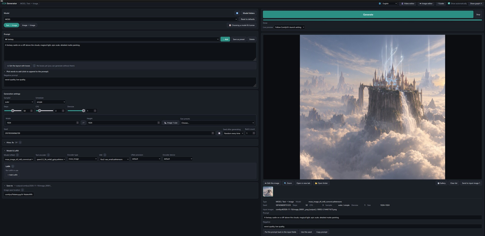

CCA Generatorは、生成した「その先」のためのComfyUIカスタムノードです。モデルを動かすだけなら、ほかのツールでもできます。CCA Generatorが得意なのは、複数の画像を混ぜて1枚にすること、編集した画像からまた生成すること、できた画像からいらないものを消すこと、画像や動画を作って、専用アプリのように編集して仕上げること。全部ひとつの場所で、全部ローカルで。


## 目次

- [インストール](#インストール)
  - [必要なもの](#必要なもの)
  - [Gitのインストール方法](#gitのインストール方法)
  - [手順1：ComfyUI Manager V3.42をインストールする](#手順1comfyui-manager-v342をインストールする)
  - [手順2：CCA Generatorをインストールする](#手順2cca-generatorをインストールする)
  - [手動インストール（代替方法）](#手動インストール代替方法)
- [テキスト→画像](#テキスト画像--おすすめモデルmoss)
- [画像→画像](#画像画像--おすすめモデルflux3-klein)
- [画像→動画](#画像動画--おすすめモデルltx-25)
- [画像編集](#画像編集--編集してまた生成する)
- [動画編集](#動画編集--作ってそのまま編集する)
- [その他 — 音楽・音声を作る](#その他--音楽音声を作る)
- [安心のガイド機能](#安心のガイド機能)
- [対応モデル](#対応モデル)
- [CCA Generatorができる、ほかのこと](#cca-generatorができるほかのこと)
- [モデルについて](#モデルについて)
- [使い方](#使い方)
- [ライセンス](#ライセンス)
- [応援](#応援)
- [他のプロジェクト](#他のプロジェクト)


## 簡易インストール (Comfyui 0.45.0以降があること)
### 必要なもの
- ComfyUI 0.45.0以上がインストール済みであること（動作確認済み：ComfyUI 0.45.0 / フロントエンド 1.59.1）。まだの場合は[こちらの手順書](https://note.com/cocoat/n/n8780c1ca3b1f#e9a103d0-79ce-43a5-b53d-f6ff8fb16a35)（StabilityMatrixでComfyUIを入れる方法）を参考にしてください。

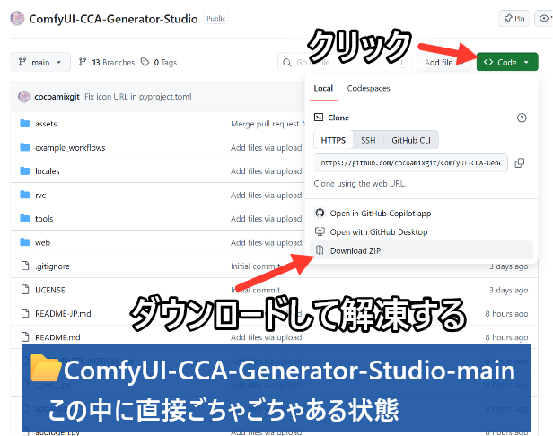
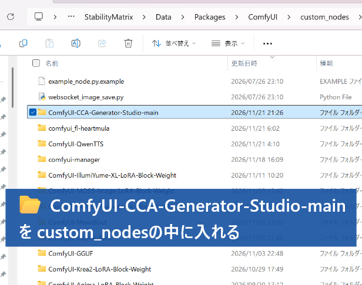
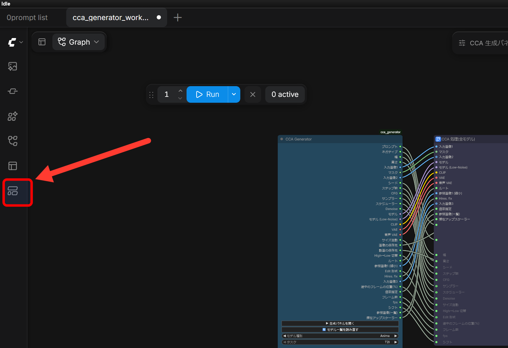
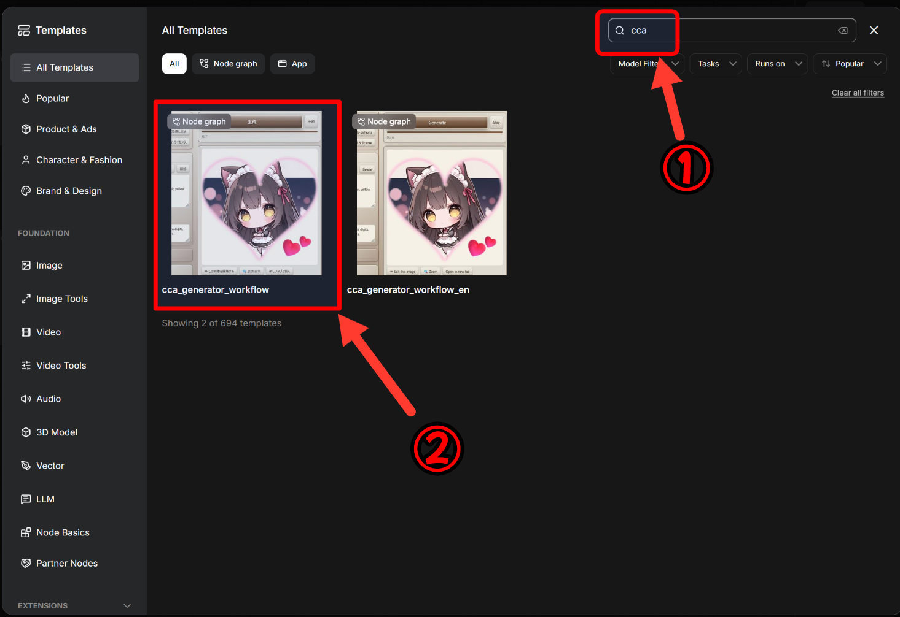


---
## 更新履歴
- 簡易インストールでインストールをした場合のアップデートの方法は、全部上書きでOKです。
- 1.2 -> 1.3 にかけてファイルの整理を行ったため、上書きでも問題ありませんが一度消してからすべて入れるとすっきりします。

### 1.6　変更・修正　-2026/11/27
* API接続を追加
* SenseNova-U1.6 でVRAMが足りない場合のlow設定追加
* SenseNova-U1.6 turboに対応
* SenseNova-U1.6に自己修復機能を追加
* 3D生成のTRELLIS.2の設定項目追加
* LoRAエクスプローラーに変更
* ギャラリーで画像が重なってしまっていたのを修正
* SenseNova-U1.6でi2iが出来ていなかったのを修正


### 1.5　変更・修正　-2026/11/26
* Forge風の配置をデフォルト設定2に追加
* SenseNova-U1.6に対応
* 3D生成のTRELLIS.2に対応
* お絵描きモード追加


### 1.4　変更・修正　-2026/11/25
* フォントの一覧で見本を表示を追加
* レイヤーの合成機能追加（通常のほか、乗算・スクリーン・オーバーレイなど）
* 色・明るさの補正機能追加（範囲指定可能）
* PDFの読み込み/保存に対応
* 文字しかないリストにプレビューを追加
* 動画にグループ機能追加（それぞれが簡単に動かせるようになりました）
* 動作改善：表示は GPU で計算するように変更
* FLUX.2 / FLUX.3 Klein・MiniMax-H3-Image でマスクが効かず、全体が描き換わるのを修正


### 1.3　変更・修正　-2026/11/24
* テーマ作成機能を追加（テンプレートの作成・取り込み、画像・文章からの作成、theme_view.html）
* 生成パネルを上・左・右・下の4つの領域に分割し、生成ボタン・生成結果・履歴などを自由に配置できる機能を追加
* 設定画面を整理
* 画像編集画面からGoogle Fontsを開けない不具合を修正
* 文字枠がキーボードの左右キーで移動しない不具合を修正


### 1.2　変更・修正　-2026/11/23
* PNG Infoの情報を取得し、設定に反映する機能を追加
* Regional Prompterのように、プロンプトの適用範囲を指定できる機能を追加
* NegPiPのような `(test:-1.0)` 形式の機能を試験的に追加（Beta版）
* 画像から作成する際、透明PNGを画像合成で2回処理することで、背景を塗りつぶせる機能を追加
* その他、プルダウンや各種設定部分などを修正

### 1.1　変更・修正　-2026/11/22
* プルダウンの不具合解消
* 上部ボタンの位置変更
* 文字内容を左寄せ・中央寄せ・右寄せ追加
* ,,で区切られた1単語、もしくは選択範囲をCtrlを押しながら方向キーの上下を押すと(test:1.1)になる機能追加。
* 画像がない状態でも編集がお絵描き出来るように変更
* クリップボードに出力を追加
* 各種説明を i　に集約
* パスツールの調整
* 画像などの拡大縮小を中心点ではなく対角点に変更し、中心点はAltで切り替え機能追加
* 画像/動画編集の並び替えボタンの位置を下に変更
* 画像編集でアートボードの外の何もないところをドラッグしたら、画面が移動するように（ハンドモード）変更。
* 現在のカーソル位置をx:/y:を表示追加。


---

## 通常インストール
### 必要なもの

- ComfyUI 0.45.0以上がインストール済みであること（動作確認済み：ComfyUI 0.45.0 / フロントエンド 1.59.1）。まだの場合は[こちらの手順書](https://note.com/cocoat/n/n8780c1ca3b1f#e9a103d0-79ce-43a5-b53d-f6ff8fb16a35)（StabilityMatrixでComfyUIを入れる方法）を参考にしてください。
- Gitがインストール済みであること。まだの場合は先にインストールしてください（下記参照）。

### Gitのインストール方法

- **Windows：** [Git for Windows](https://git-scm.com/downloads) をダウンロードしてインストーラーを実行します。設定はデフォルトのままで大丈夫です。
- **macOS：** `xcode-select --install` を実行するか、Homebrewを使っている場合は `brew install git` を実行します。
- **Linux：** `sudo apt install git`（Debian / Ubuntu系）を実行します。ほかのディストリビューションではそれぞれのパッケージマネージャーでインストールしてください。

インストールできたら、以下で確認します。

```bash
git --version
```

バージョン番号が表示されればOKです。

### 手順1：ComfyUI Manager V3.42をインストールする

ComfyUI Managerをまだ入れていない場合は、先にインストールしてください。

**ご自分のComfyUIのインストールフォルダ**にある `custom_nodes` フォルダでターミナルを開いてください。場所はComfyUIの導入方法によって違います。

- Windows Portable版：`ComfyUI_windows_portable/ComfyUI/custom_nodes`
- StabilityMatrix：`C:\StabilityMatrix\Data\Packages\ComfyUI\custom_nodes`
- 手動インストール：ComfyUIをcloneした場所の `custom_nodes`

その後、以下を実行します。

```bash
git clone https://github.com/Comfy-Org/ComfyUI-Manager.git comfyui-manager
```

次に、ComfyUIを動かしているのと同じPythonで依存ライブラリをインストールします。

**Windows Portable版**（`ComfyUI_windows_portable` フォルダで実行）：

```bash
.\python_embeded\python.exe -m pip install -r ComfyUI\custom_nodes\comfyui-manager\requirements.txt
```

**手動インストール／venv環境**（ご自分のComfyUIフォルダで実行）：

```bash
pip install -r custom_nodes/comfyui-manager/requirements.txt
```

ComfyUIを再起動すると、**Manager**ボタンが表示されます。

> フォルダは必ず `<ComfyUIのフォルダ>/custom_nodes/comfyui-manager` にしてください。`ComfyUI-Manager/ComfyUI-Manager` のような二重フォルダにならないよう注意してください。

### 手順2：CCA Generatorをインストールする

1. **Manager**をクリックして**Custom Nodes Manager**を開きます。
2. **CCA Generator**を検索して**Install**をクリックします。
3. ComfyUIを再起動します。

### 手動インストール（代替方法）

```bash
cd <ComfyUIのフォルダ>/custom_nodes
git clone https://github.com/cocoamixgit/ComfyUI-cca-generator-ui.git
```

`<ComfyUIのフォルダ>` はご自分のComfyUIのインストール先に読み替えてください。その後、ComfyUIを再起動してください。


## テキスト→画像 — おすすめモデル：MOSS

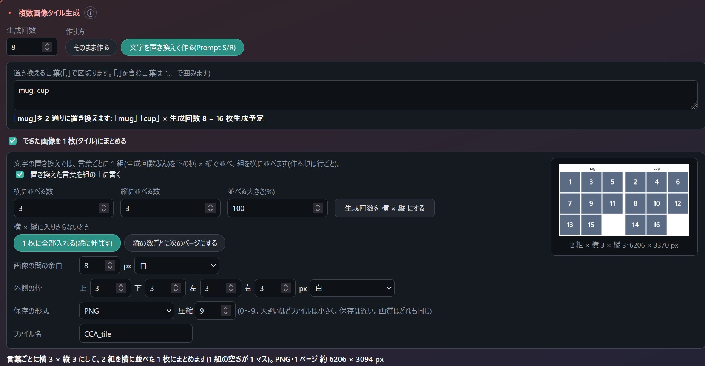

モデルを選んで、プロンプトを書いて、「生成」を押すだけ。SD1.5やSDXLといった定番から、最新の画像モデルまで。設定はモデル・タスクごとに覚えているので、モデルを切り替えても前回の設定に戻ります。生成は作業の始まりです。ここから先が、CCA Generatorの本領です。

**機能**

- プロンプトプリセット（保存・追加・削除）、おすすめ★プリセット。Forge / A1111のstyles.csv（Forgeのアプリ本体と同じフォルダにあるもの）もプリセットとして読み込める
- ことばを選んで足す、ワイルドカード（`__名前__` で毎回ランダムに置き換え）
- 入力画像からプロンプトを作る、枠で配置を指定（MOSS）
- LoRAはいくつでも（強度・CLIPの強度・High / Low・オン／オフ）
- サイズ・倍率・サイズプリセット、Hires. fix
- シード・生成回数、できた画像を1枚のタイルにまとめる

## 画像→画像 — おすすめモデル：FLUX.3 Klein

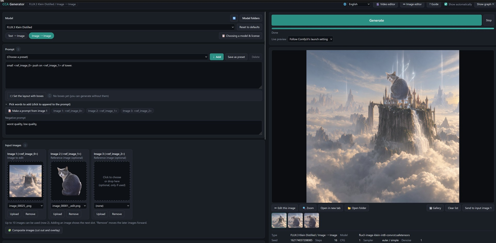

1枚入れて1枚出すだけじゃありません。Qwen ImageとFLUXなら、生成した背景、切り抜いた被写体、雰囲気の参考画像など、複数の画像を持ち寄って1枚の新しい画像に合成できます。参照画像、枠での配置指定、マスク。部品はCCA Generatorが用意します。絵を決めるのはあなたです。編集した画像はそれで終わりじゃありません。そのまま渡して、続きを作れます。

**機能**

- 入力画像1〜10枚（モデルによる）
- 複数画像を混ぜて1枚に（Qwen Image / FLUX）
- 画像の合成（配置・切り抜き・背景を消す）
- マスクを描いて部分だけ描き直す
- ノイズ除去強度、大きさの合わせ方（そのまま・切り抜いて・余白を埋めて）

## 画像→動画 — おすすめモデル：LTX-2.5

<video src="assets/video-generation.mp4" controls width="100%"></video>

画像から動画を生成して、最初・最後・中間のフレーム指定に、音・セリフの追加まで。作った動画はそのまま動画編集で開けます。

**機能**

- 最初・最後・中間のフレーム指定
- 音・セリフの追加（LTX-2.5 / Kandinsky 6）
- 動画の長さ（フレーム数）・fps・シフト

## 画像編集 — 編集して、また生成する

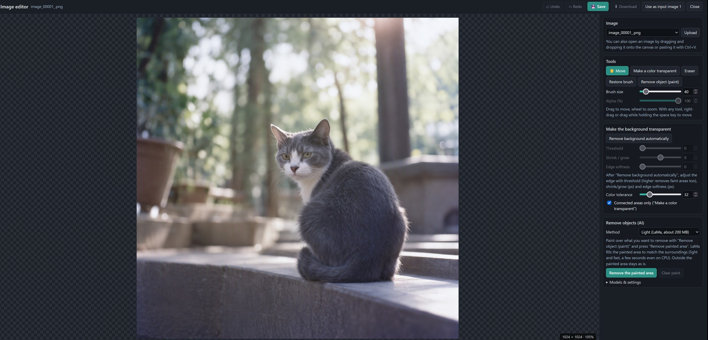

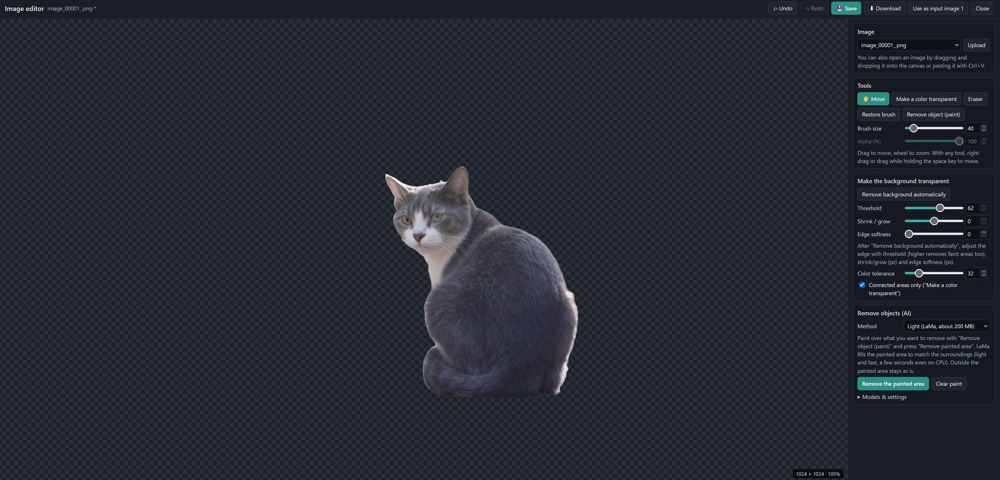

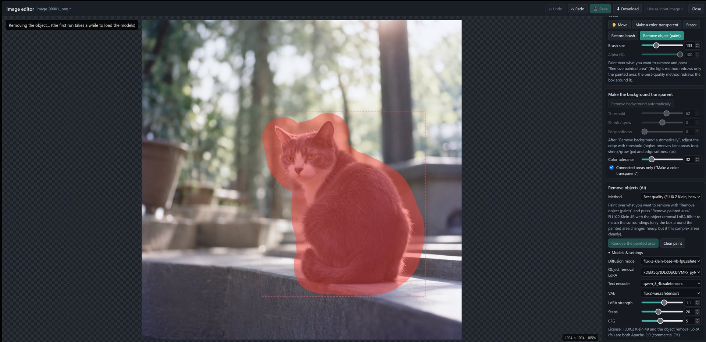

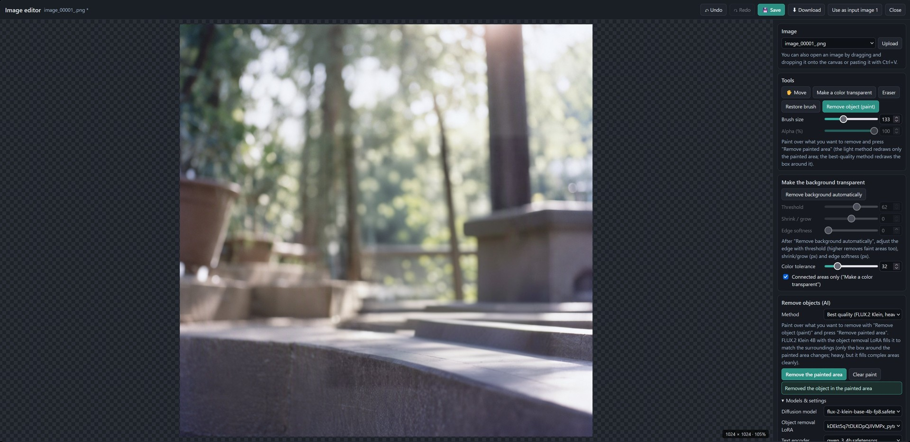

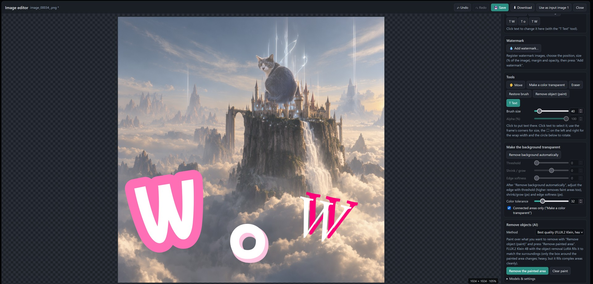

背景削除はワンクリック。しきい値・縮める／広げる・縁のぼかしで微調整できます。いらないものは塗って消すだけ。周りに合わせて自然に埋めてくれます。軽くて速いLaMaと、きれいなFLUX.2 Kleinの2つの方法から選べます。消しゴム、戻すブラシ、色で透明にする機能も備えています。文字は縁取りや影つきで入れられて、登録した透かし画像は四隅や中央に、大きさ・余白・不透明度を指定して押せます。編集した画像はそれで終わりじゃありません。そのまま画像→画像に渡して、続きを作れます。

**機能**

- 背景削除はワンクリック（しきい値・縮める／広げる・縁のぼかし）
- オブジェクト除去：軽くて速いLaMaと、きれいなFLUX.2 Klein（色合わせつき）
- 消しゴム・戻すブラシ・モザイクブラシ・色で抜く
- レイヤー（画像・文字・図形）、図形ツール（四角・角丸・丸・三角・線・矢印・ペン）
- キャンバスのリサイズ・トリミング、書き出し（PNG / JPEG / WebP）
- 文字（縁取り・影・テンプレート共通）、透かし
- 一時保存と履歴、元に戻す／やり直す
- 画像ごとに14の形に切り取る（四角・丸・三角・星・ハート・花など）、ふちのぼかしつき
- 下のレイヤーで切り抜く、タイル／水玉の並べ方、ふち取り
- パスツール：点と曲線でパスを描く、内側・外側の削除、塗りつぶし、線の描画、処理を適用
- 書き出される範囲の強調表示（枠の線・色・太さ）

## 動画編集 — 作って、そのまま編集する

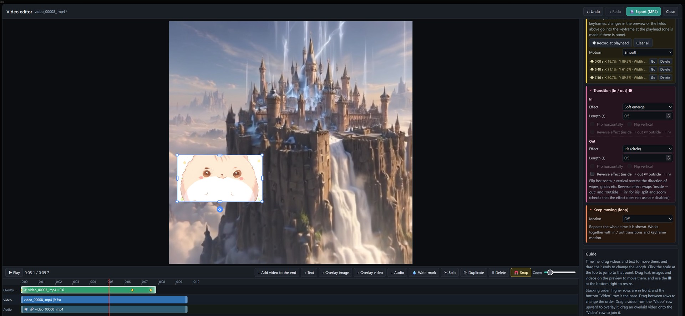

CCA Generatorで編集した例：
<video src="assets/ccageneratormoview1.mp4" controls width="100%"></video>
<video src="assets/video-edited.mp4" controls width="100%"></video>

モザイクを入れた例：

<video src="assets/video-mosaic.mp4" controls width="100%"></video>

作った動画はそのままCCA Generatorで編集できます。つなげる・切る・分ける、字幕、画像や動画の重ね合わせ、Google Fonts、MP4・WebM・WebPアニメ・透過GIFへの書き出し。タイムラインでは重ね合わせの動きをキーフレームで付けられて、入／出のトランジション、透かし、モザイク、音声トラック、タイムストレッチも使えます。

**機能**

- つなげる・切る・分ける、画面の切り取り
- 文字（字幕）・画像・動画の重ね合わせ
- キーフレームの動き、登場・退場モーション、ループモーション
- 入／出のトランジション、ぼかし、モザイク
- 音声の段（音量・ミュート・フェード・音量キーフレーム・波形）
- 背景を透明に（色で抜く・AI・元の透明度）、タイムストレッチ
- 書き出し（MP4 / WebM / WebPアニメ・透過GIF）、一時保存と履歴
- 図形マスク：選んだ形だけ見せる（14の形）、回す・揺れる・伸び縮みのアニメーションつき
- 下のレイヤーで切り抜く、タイル／水玉の並べ方、ふち取り
- 図形のレイヤーとパス描画
- 書き出される範囲の強調表示（枠の線・色・太さ）

## その他 — 音楽・音声を作る

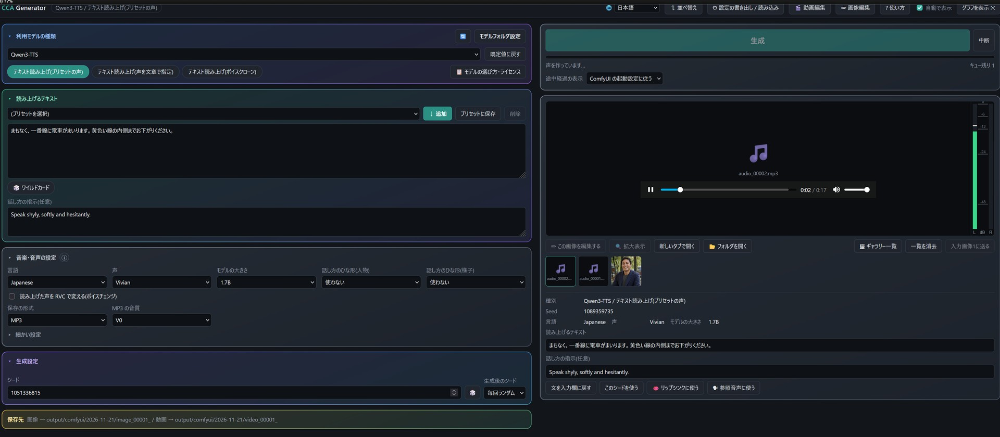

CCA Generatorで音楽や音声も作れます。Qwen3-TTSはテキストの読み上げ・声の文章指定・ボイスクローン、HeartMuLaは歌入りの曲、ACE-Step 1.5は曲、LatentSync 1.6はリップシンク、RVCは音声の声を変えます。動画・音声のプレビューにはレベルメーターが付いています。

**機能**

- Qwen3-TTS：テキスト読み上げ・ボイスクローン・声の文章指定
- HeartMuLa：歌入りの曲、ACE-Step 1.5：曲
- LatentSync 1.6：リップシンク
- RVC：音声の声を変える（Qwen3-TTSの読み上げにも使える）
- レベルメーター（左・右、dB）、音声専用のプリセット

## 安心のガイド機能

ファイルが見つからないとき、CCA Generatorが配布ページと入れる場所を教えてくれます。Hugging Face・Civitai・Googleでの検索リンクに、フォルダを開く・パスをコピーするボタンつき。壊れた（途中で切れた）ファイルも読み込む前に検出します。

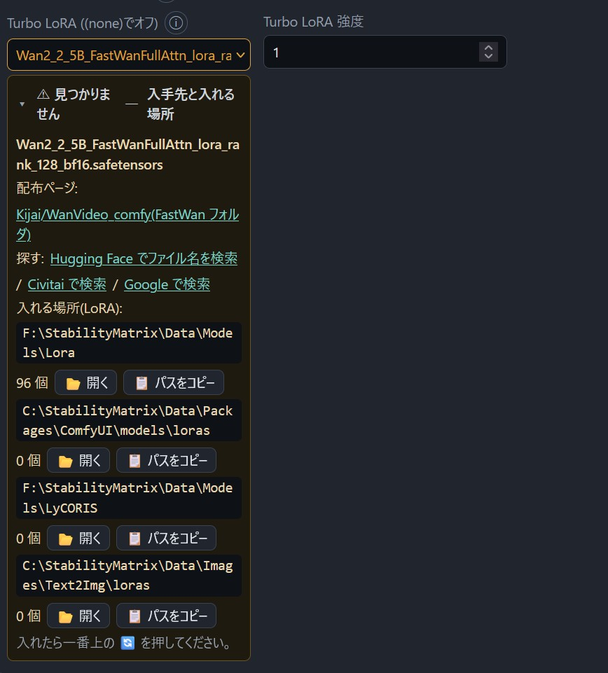

モデルの選び方もCCA Generatorが案内します。種別ごとに公式配布のファイル一覧が表示され、おすすめ・大きさ・ライセンス・このPCへの導入状態がひと目でわかります。

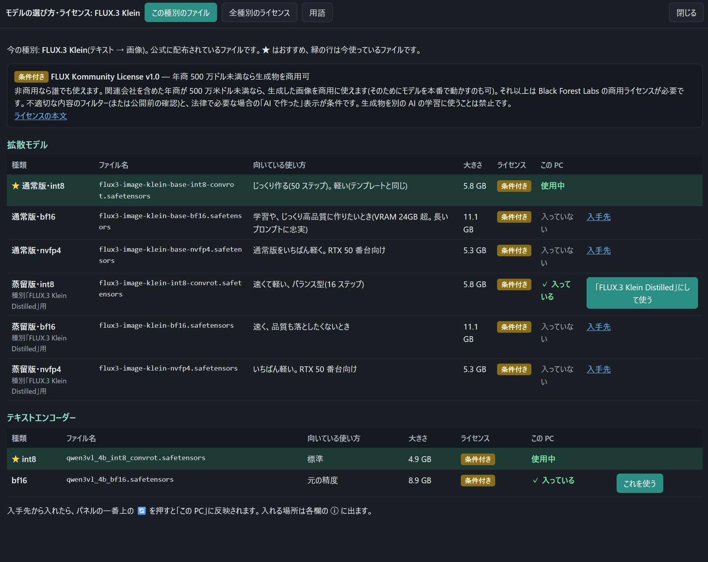

## 対応モデル

**画像：** MOSS、MOSS Turbo、SD1.5、SDXL、Illustrious、Anima、Krea 2、Qwen Image、Qwen Image Turbo、FLUX.2 Klein（4B / 9B / Base）、FLUX.3 Klein、FLUX.3 Klein Distilled

**動画：** Wan2.2 14B / 14B Turbo / 5B / 5B Turbo、LTX-2.5、Kandinsky 6

**音声：** Qwen3-TTS、LatentSync 1.6、HeartMuLa、ACE-Step 1.5、RVC

Qwen3-TTSには追加ノード「ComfyUI-QwenTTS」が必要です。ComfyUI Managerからのインストールに失敗したときは、PowerShellでComfyUIのフォルダに移動し、`.\venv\Scripts\python.exe -m pip install qwen-tts` を実行してください。

## CCA Generatorができる、ほかのこと

- **モデル** — モデルフォルダの追加は、StabilityMatrixのフォルダをまとめて追加することもできる
- **設定** — CCA Generatorの設定・プリセット・ワイルドカード・テンプレート・編集画面の設定・項目の並び・モデルフォルダを1つのファイルに書き出し、足す／置き換えるで読み込める
- **速い** — 分割実行：シードだけ変えた再生成では、モデルを読み直さない
- **言語** — 日本語・英語の切り替えつき（自動判定あり）


## モデルについて

このノードにモデルは同梱されていません。モデルをまだ用意していない場合は、CCA Generatorのモデルセットアップ補助がダウンロードと配置場所を案内します。モデルの選び方やライセンス条件は、CCA Generator内のモデルガイドをご覧ください。

## 使い方

1. **ワークフローを開く** — ComfyUIのテンプレート一覧（Workflow → Browse Workflow Templates）からCCA Generatorのワークフローを開くか、`example_workflows/cca_generator_workflow.json`（日本語）／`example_workflows/cca_generator_workflow_en.json`（英語）をキャンバスにドラッグ＆ドロップしてください。
2. **モデルを選ぶ** — モデルのドロップダウンから使うモデル（例：MOSS、LTX-2.5）を選びます。モデルの保存場所はモデルフォルダ設定で指定できます。
3. **タスクを選ぶ** — テキスト→画像、画像→画像、テキスト→動画、画像→動画のいずれかを選びます。
4. **プロンプトを入れる** — プリセットから選ぶか、直接入力します。動画では音・セリフも書けます。
5. **入力画像を指定する** — 画像→画像・画像→動画の場合。入力画像1が最初のフレーム、入力画像2が最後のフレーム（任意）です。クリックで選ぶか、ドラッグ＆ドロップで追加できます。
6. **「生成」を押す** — 中断したいときは「中断」を押してください。生成中の進捗が表示されます。
7. **結果を編集する** — 画像は画像編集（背景切り抜き・部分削除）、動画は動画編集（結合・字幕・重ね合わせ）で開けます。
8. **結果を確認する** — ギャラリーで画像や動画をプレビューし、拡大したり出力フォルダを開いたりできます。

## ライセンス

### このノード

CCA GeneratorはGPL-3.0です — [LICENSE](LICENSE)をご覧ください。

このノードは「現状のまま」提供され、いかなる保証もありません。ご利用は自己責任でお願いします。利用によって生じたいかなる損害・損失についても、責任は一切負いません。（GPL-3.0 第15〜17条）

### モデルのライセンス

このノードにモデルは同梱されていません。ダウンロードするモデルにはそれぞれ独自のライセンスがあり、モデルの重み（モデルによっては製品での利用方法にも）適用されます。下の一覧は2026年11月時点のまとめです。商用利用の前には、ダウンロードするチェックポイントのモデルページにあるライセンスを必ず確認してください。

| モデル | ライセンス | 商用利用 |
|---|---|---|
| MOSS / MOSS Turbo | Apache-2.0 | 可 |
| SD1.5 | CreativeML Open RAIL-M | 可（用途制限あり） |
| SDXL | CreativeML Open RAIL++-M | 可（用途制限あり） |
| Illustrious | チェックポイントによる — v0.1: Fair AI Public License 1.0-SD、v2.0: CreativeML Open RAIL-M | 使うチェックポイントを確認 |
| Anima | CircleStone Labs Non-Commercial License（＋NVIDIA Open Model License） | モデル自体の商用利用：不可、生成した画像の商用利用：可 |
| Krea 2 | Krea 2 Community License | 年間売上$1M未満かつ50席未満なら無料で可 |
| Qwen Image | Apache-2.0 | 可 |
| Qwen Image Turbo | Apache-2.0 | 可 |
| FLUX.2 Klein 4B / 4B Base | Apache-2.0 | 可 |
| FLUX.2 Klein 9B / 9B Base | FLUX Non-Commercial License | モデル自体の商用利用：不可、生成した画像の商用利用：可 |
| FLUX.3 Klein / FLUX.3 Klein Distilled | FLUX Kommunity License v1.0 | 生成画像のみ、年間売上$5M未満のユーザーに限る |
| Wan2.2（14B / 14B Turbo / 5B / 5B Turbo） | Apache-2.0 | 可 |
| LTX-2.5 | LTX-2.x Community License | 年間売上$10M未満なら無料で可 |
| Kandinsky 6 | MIT（モデル本体）。HunyuanVideoのVAEはTencent Hunyuan Community License（EU・イギリス・韓国では適用されない） | 可、ただし下の注記参照 |
| Qwen3-TTS | Apache-2.0 | 可 |
| LatentSync 1.6 | CreativeML Open RAIL++-M（コード：Apache-2.0） | 可（用途制限あり） |
| HeartMuLa | Apache-2.0 | 可 |
| ACE-Step 1.5 | MIT | 可 |
| RVC | MIT | 可 |

注記：

- **Qwen Image Turbo：** 初代Qwen-ImageにLightX2VのQwen-Image-Lightning 8ステップLoRA（`Qwen-Image-Lightning-8steps-V1.1.safetensors`）を組み合わせたものです。Qwen-Image-2.1-Turbo（Qwen Research License・非商用）とは別物です。
- **Illustrious：** バージョンによってライセンスが違い、コミュニティのマージは元になったものの条件を引き継ぎます。ダウンロードするチェックポイントのページを確認してください。
- **Kandinsky 6：** モデル自体はMITですが、使っている動画VAEはHunyuanVideoのもので、Tencent Hunyuan Community Licenseがかかります。このライセンスはEU・イギリス・韓国では適用されず、月間アクティブユーザー1億人を超える製品はTencentとの別途契約が必要です。ほかの部品（Qwen2.5-VLテキストエンコーダー、CLIP、MMAudio VAE、BigVGANボコーダー）はゆるいライセンスです。
- このまとめは法的な助言ではありません。判断に迷う場合は、モデルに付属するライセンス本文をお読みください。

## 応援

このノードが役に立ったら、[Ko-fiでCCA Generatorを応援](https://ko-fi.com/cocoat)できます。

## 他のプロジェクト

[cocoamix](https://civitai.com/collections/13386306) — SD1.5の時代から作り続けているチェックポイントモデルで、現在はMOSS向けもあります。

[](https://civitai.com/collections/13386306)
