# CCA Generator

[日本語版はこちら](README-JP.md)

Generate, edit, and finish — images and video in CCA Generator.

> **Please note:** This node is published for free. No further updates are planned, bugs may not be fixed, and criticism is not accepted. Please use it as is.

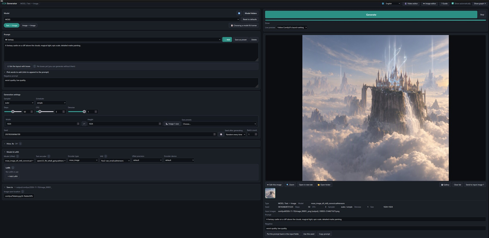

CCA Generator is a ComfyUI custom node for everything after generation. Running a model is the easy part — plenty of tools do that. What CCA Generator is for: blend several images into one, edit a picture and generate from it again, erase what you don't want from a finished image, make images and video, then edit and polish them like you would in a dedicated editor. All in one place, all local.


## Contents

- [Installation](#installation)
  - [Prerequisites](#prerequisites)
  - [Installing Git](#installing-git)
  - [Step 1: Install ComfyUI Manager V3.42](#step-1-install-comfyui-manager-v342)
  - [Step 2: Install CCA Generator](#step-2-install-cca-generator)
  - [Manual install (alternative)](#manual-install-alternative)
- [Text → Image](#text--image--recommended-model-moss)
- [Image → Image](#image--image--recommended-model-flux3-klein)
- [Image → Video](#image--video--recommended-model-ltx-25)
- [Edit images](#edit-images--then-generate-from-them-again)
- [Edit video](#edit-video--make-it-then-edit-it-in-cca-generator)
- [Other — Make music and voice](#other--make-music-and-voice)
- [The guide feature](#the-guide-feature)
- [Supported models](#supported-models)
- [More of what CCA Generator does](#more-of-what-cca-generator-does)
- [Models](#models)
- [Usage](#usage)
- [License](#license)
- [Support](#support)
- [Other projects](#other-projects)


##  easy Installation (over Comfyui 0.45.0)
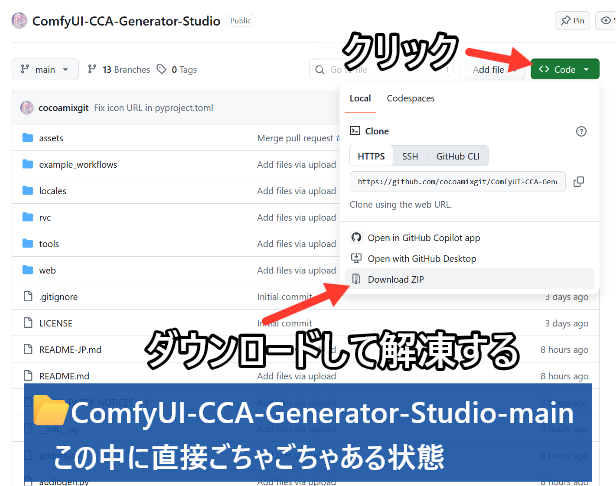
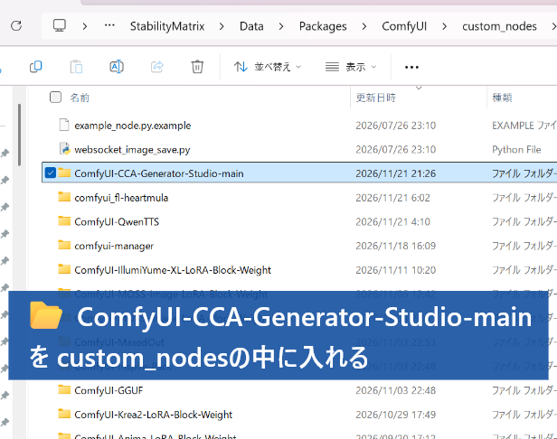
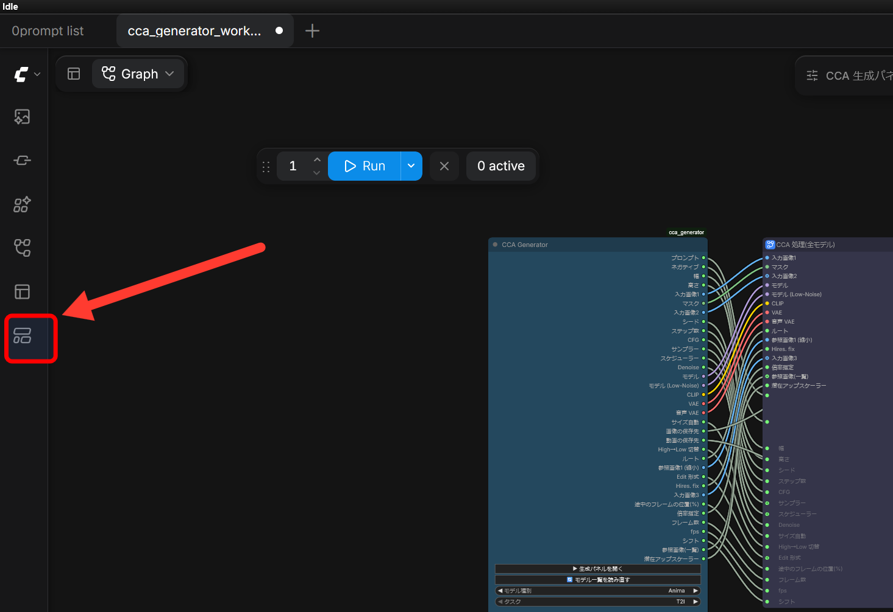
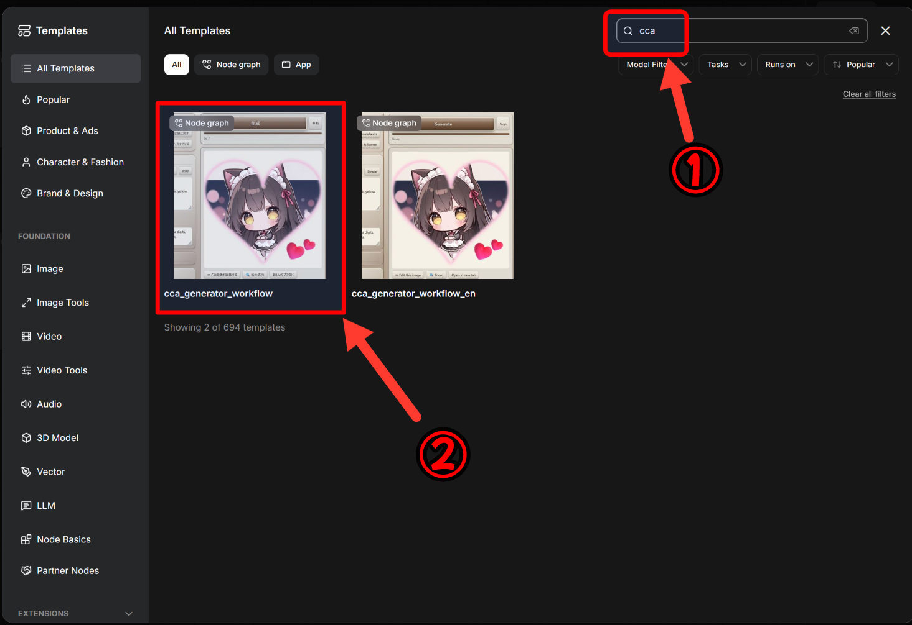

---
## Changelog
- If you installed using the Quick Installer, updating is as simple as overwriting all existing files.
Note: The file structure was reorganized between versions 1.2 and 1.3. Overwriting the existing files is fine, but for a cleaner installation, it is recommended to delete the existing files first and then install all files again.

### Version 1.6 – Changes & Fixes
* Added API connectivity.
* Added a Low VRAM mode for SenseNova-U1.6 when available VRAM is insufficient.
* Added support for SenseNova-U1.6 Turbo.
* Added a self-repair feature for SenseNova-U1.6.
* Added additional configuration options for TRELLIS.2 3D generation.
* Reworked the LoRA Explorer.
* Fixed an issue where images overlapped in the Gallery.
* Fixed an issue that prevented image-to-image (I2I) generation from working with SenseNova-U1.6.


### Version 1.5 – Changes & Fixes  -2026/11/26
* Added a Forge-style layout as Default Settings 2.
* Added support for SenseNova-U1.6.
* Added support for TRELLIS.2 3D generation.
* Added Drawing Mode.


### Version 1.4 – Changes & Fixes  -2026/11/25
* Added font previews to the font list.
* Added layer blending modes, including Normal, Multiply, Screen, and Overlay.
* Added color and brightness adjustment tools with selectable adjustment areas.
* Added support for importing and exporting PDF files.
* Added previews to text-only lists.
* Added grouping functionality for videos, making it easier to move individual elements independently.
* Performance improvement: Switched display rendering calculations to the GPU.
* Fixed an issue where masks were ignored in FLUX.2, FLUX.3 Klein, and MiniMax-H3-Image, causing the entire image to be regenerated instead of only the masked area.


### Version 1.3 – Changes & Fixes  -2026/11/24
* Added theme creation features (template creation and import, theme creation from images or text, and theme_view.html)
* Added a customizable generation panel layout with four areas: top, left, right, and bottom, allowing generation buttons, generated images, history, and other elements to be freely rearranged
* Organized the settings screen
* Fixed an issue preventing Google Fonts from opening in the image editor
* Fixed an issue where text frames could not be moved using the left and right arrow keys
  

### Version 1.2 – Changes & Fixes  -2026/11/23
* Added the ability to retrieve PNG Info and apply the information to settings.
* Added a feature for specifying prompt regions, similar to Regional Prompter.
* Experimentally added a NegPiP-like `(test:-1.0)` syntax feature (Beta).
* Added a feature that allows transparent PNG backgrounds to be filled by processing image composition twice when creating images.
* Fixed and improved various dropdown menus and settings.

### Version 1.1 – Changes & Fixes  -2026/11/22
* Fixed dropdown menu issues.
* Adjusted the positioning of the top buttons.
* Added left, center, and right text alignment options.
* Added a feature that allows you to hold Ctrl and press the Up/Down arrow keys to convert a single word separated by `,,` or the selected text into `(test:1.1)` format.
* Enabled editing and drawing even when no image is loaded.
* Added a Copy to Clipboard output option.
* Consolidated all help and instructions under the ⓘ (Info) button.
* Improved the Path Tool.
* Changed the scaling anchor point for images and other objects from the center to the opposite corner. Hold Alt to switch back to center-based scaling.
* Moved the reorder buttons to the bottom of the image/video editing interface.
* Added Hand Mode to image editing: drag anywhere on the empty area outside the artboard to pan the canvas.
* Added a display showing the current cursor coordinates (`X:` / `Y:`).

---


## Normal Installation
### Prerequisites

- ComfyUI 0.45.0 or later installed (verified on ComfyUI 0.45.0 / frontend 1.59.1). If you don't have ComfyUI yet, see [this setup guide (Japanese)](https://note.com/cocoat/n/n8780c1ca3b1f#e9a103d0-79ce-43a5-b53d-f6ff8fb16a35) — it walks through installing ComfyUI with StabilityMatrix.
- Git installed. If you don't have Git yet, install it first (see below).

### Installing Git

- **Windows:** Download [Git for Windows](https://git-scm.com/downloads) and run the installer. The default options are fine.
- **macOS:** Run `xcode-select --install`, or `brew install git` if you use Homebrew.
- **Linux:** Run `sudo apt install git` (Debian / Ubuntu) or the equivalent for your distribution.

Then verify:

```bash
git --version
```

If it prints a version number, you're good to go.

### Step 1: Install ComfyUI Manager V3.42

If you don't have ComfyUI Manager yet, install it first.

Open a terminal in the `custom_nodes` folder inside **your** ComfyUI installation. The location depends on how you installed ComfyUI:

- Windows Portable: `ComfyUI_windows_portable/ComfyUI/custom_nodes`
- StabilityMatrix: `C:\StabilityMatrix\Data\Packages\ComfyUI\custom_nodes`
- Manual install: `custom_nodes` inside the folder where you cloned ComfyUI

Then run:

```bash
git clone https://github.com/Comfy-Org/ComfyUI-Manager.git comfyui-manager
```

Then install its dependencies with the same Python that runs ComfyUI:

**Windows Portable** (run from the `ComfyUI_windows_portable` folder):

```bash
.\python_embeded\python.exe -m pip install -r ComfyUI\custom_nodes\comfyui-manager\requirements.txt
```

**Manual install / venv** (run from your ComfyUI folder):

```bash
pip install -r custom_nodes/comfyui-manager/requirements.txt
```

Restart ComfyUI. The **Manager** button should appear.

> The folder must be exactly `<your ComfyUI folder>/custom_nodes/comfyui-manager`. Do not leave a nested folder like `ComfyUI-Manager/ComfyUI-Manager`.

### Step 2: Install CCA Generator

1. Click **Manager** and open **Custom Nodes Manager**.
2. Search for **CCA Generator** and click **Install**.
3. Restart ComfyUI.

### Manual install (alternative)

```bash
cd <your ComfyUI folder>/custom_nodes
git clone https://github.com/cocoamixgit/ComfyUI-cca-generator-ui.git
```

Replace `<your ComfyUI folder>` with the path to your own ComfyUI installation. Then restart ComfyUI.


## Text → Image — recommended model: MOSS

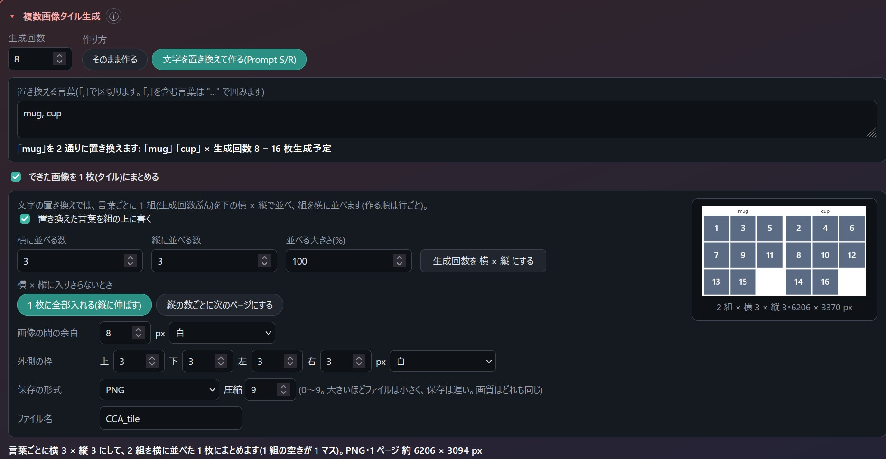

Pick a model, type a prompt, press Generate — from the classics like SD1.5 and SDXL to the latest image models. Settings are remembered per model and task, so switching models brings your last setup back. Generation is where the work starts; the sections below are where it goes.

**Features**

- Prompt presets (save / add / delete) and recommended ★ presets; a Forge / A1111 styles.csv file — the one in the same folder as the Forge app itself — imports as presets
- Click-to-append words, and wildcards (`__name__` swaps in a random line each time)
- Build a prompt from an input image, layout boxes (MOSS)
- Any number of LoRAs, each with its own strength, CLIP strength, High / Low, on / off
- Size, scale and size presets, Hires. fix
- Seed control and batch count; combine finished images into one tiled sheet

## Image → Image — recommended model: FLUX.3 Klein

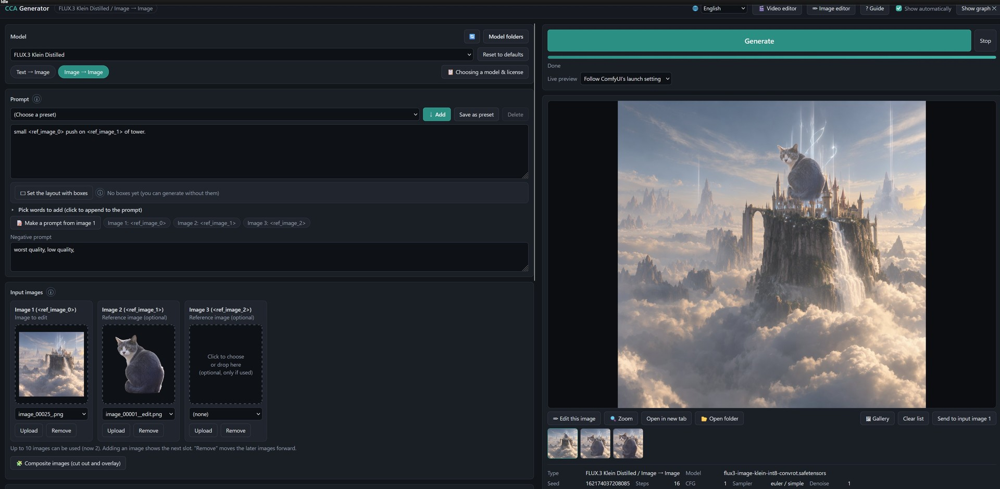

Not just one image in, one image out. With Qwen Image and FLUX, bring several images — a background you generated, a subject you cut out, a style reference — and blend them into a single new image. Reference images, layout boxes and masks give you the pieces; you decide the picture. And an edited picture isn't a dead end: feed it straight back in and keep going.

**Features**

- 1–10 input images (model-dependent)
- Blend several images into one (Qwen Image / FLUX)
- Compositing: placement, cutout, background removal
- Painted masks to redraw only part of an image
- Denoise strength and size matching (keep / as-is / crop / pad)

## Image → Video — recommended model: LTX-2.5

<video src="assets/video-generation.mp4" controls width="100%"></video>

Generate video from an image, with first / last / middle frame control and optional audio and dialogue lines. A finished video opens straight into the video editor.

**Features**

- First / last / middle frame control
- Audio and dialogue lines (LTX-2.5 / Kandinsky 6)
- Length (frames), fps, shift

## Edit images — then generate from them again

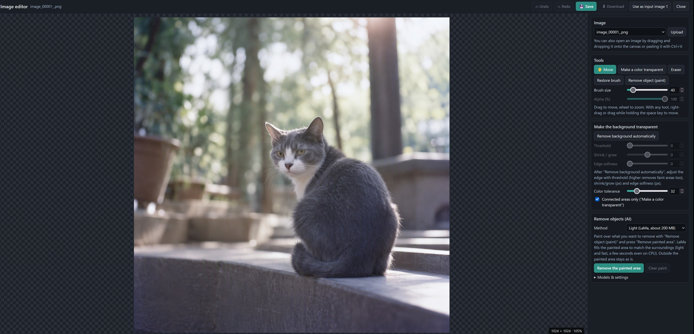

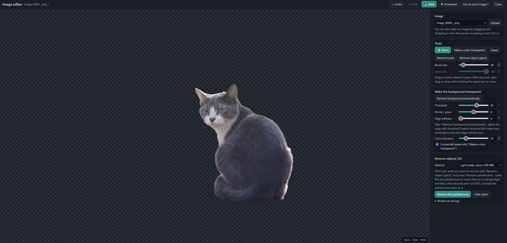

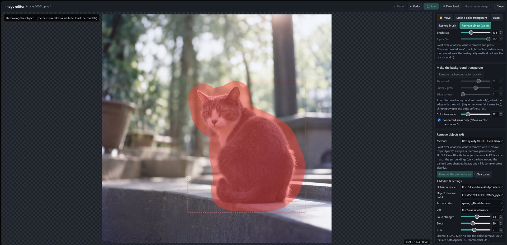

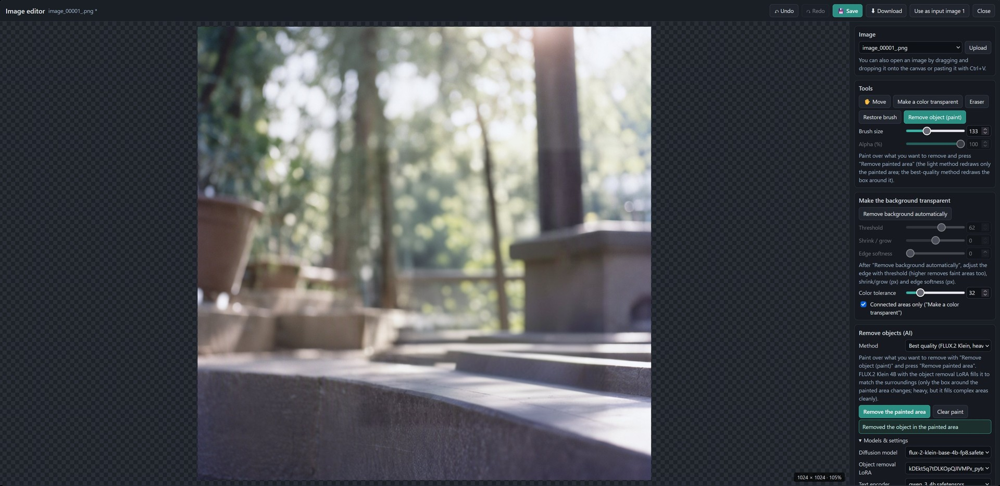

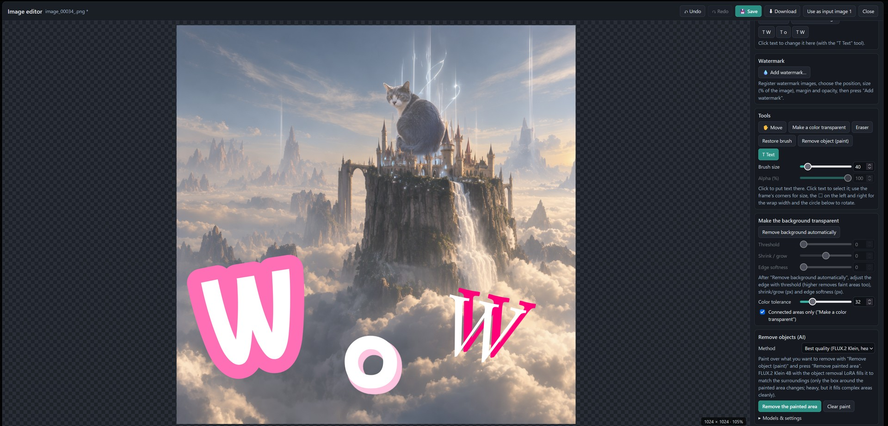

Background removal in one click, with threshold, shrink / grow and edge softness to fine-tune it. Paint over anything you don't want and it's gone, filled in to match the surroundings — light and fast with LaMa, or high quality with FLUX.2 Klein. Eraser, restore brush and make-a-color transparent round it out. Text goes on with an outline and shadow, and a registered watermark image can be stamped at any corner or the center, with size, margin and opacity. And the edited picture isn't a dead end: feed it straight back into image-to-image and keep going.

**Features**

- One-click background removal (threshold, shrink / grow, edge softness)
- Object removal: light and fast with LaMa, or high quality with FLUX.2 Klein — with color matching
- Eraser, restore brush, mosaic brush, make-a-color transparent
- Layers: stack images, text and shapes; shape tools (rectangle, rounded, ellipse, triangle, line, arrow, pen)
- Canvas resize and crop (with ratios), export to PNG / JPEG / WebP
- Text with outline and shadow, shared templates, watermark stamping
- Autosave and history, undo / redo
- Crop each placed image into 14 shapes (rectangle, ellipse, triangle, star, heart, flower and more), with feathered edges
- Clip with the layer below, tile / polka-dot fill patterns, outlines around opaque areas
- Path tool: place points and curves, delete inside / outside, fill, draw lines; bake crop and outline into pixels
- Export range highlight (frame line with color and thickness)

## Edit video — make it, then edit it in CCA Generator

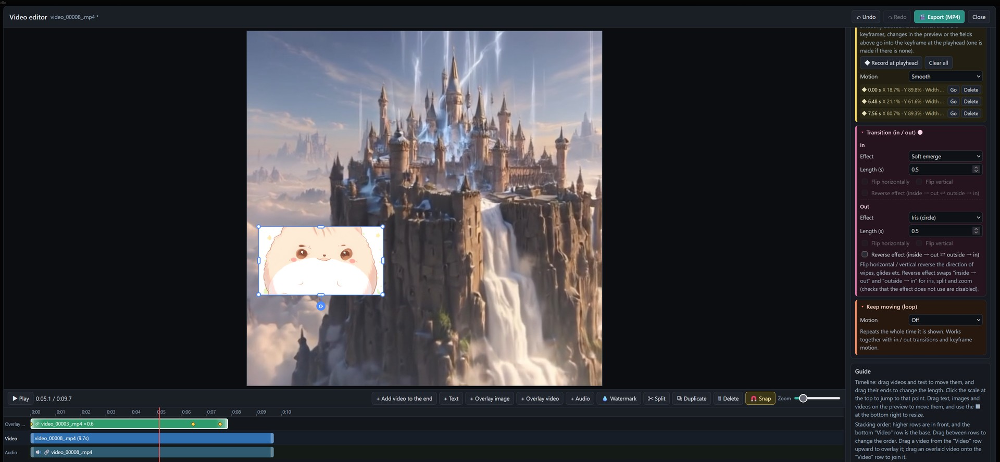

Edited in CCA Generator:

<video src="assets/ccageneratormoview1.mp4" controls width="100%"></video>
<video src="assets/video-edited.mp4" controls width="100%"></video>

With mosaic added:

<video src="assets/video-mosaic.mp4" controls width="100%"></video>

Edit it in CCA Generator: join, trim, split, subtitles, picture-in-picture overlays, Google Fonts, and export to MP4, WebM, animated WebP and transparent GIF. The timeline adds keyframed motion for overlays, in/out transitions, watermarks, mosaic, a separate audio track, and time stretch.

**Features**

- Join, trim, split, crop the frame
- Text (subtitles), image and video overlays
- Keyframed motion, entrance / exit motion, looping motion
- In / out transitions, blur, mosaic
- Audio track: volume, mute, fade, volume keyframes, waveform
- Transparent background (chroma key, AI, native alpha), time stretch
- Export to MP4, WebM, animated WebP and transparent GIF; autosave and history
- Shape masks: show only the selected shape (14 shapes), with rotation, swing and pulse animation
- Clip with the layer below, tile / polka-dot patterns, outlines
- Shape layers and path drawing on the preview
- Export range highlight (frame line with color and thickness)

## Other — Make music and voice

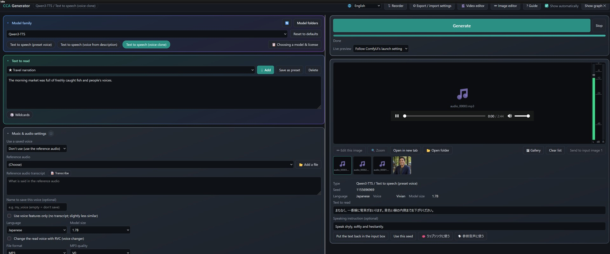

Generate music and voice in CCA Generator: Qwen3-TTS reads text aloud, clones a voice from a sample, or takes a voice description; HeartMuLa makes songs with vocals; ACE-Step 1.5 makes music; LatentSync 1.6 syncs lips to audio; RVC changes the voice of any audio. A level meter shows the left / right levels on video and audio previews.

**Features**

- Qwen3-TTS: text-to-speech, voice cloning, voice by description
- HeartMuLa: songs with vocals; ACE-Step 1.5: music
- LatentSync 1.6: lip sync for video
- RVC: change the voice of any audio (also on Qwen3-TTS output)
- Level meter (left / right, dB) on video and audio previews
- Separate audio presets

## The guide feature

When a file is missing, CCA Generator shows you where to get it and where to put it — with search links for Hugging Face, Civitai and Google, and buttons to open the folder or copy the path. Broken (truncated) files are detected before loading.

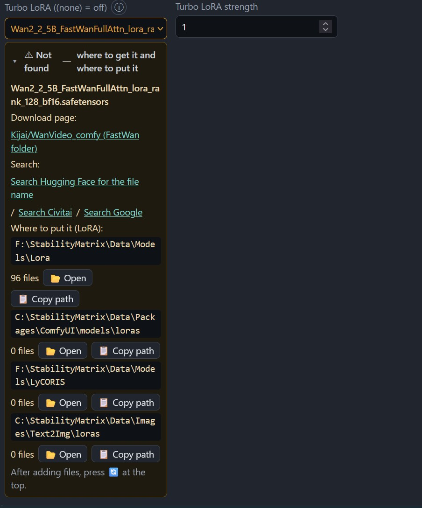

Choosing a model is guided too: each type lists its officially distributed files, with the recommended pick, size, license, and install status on this PC at a glance.

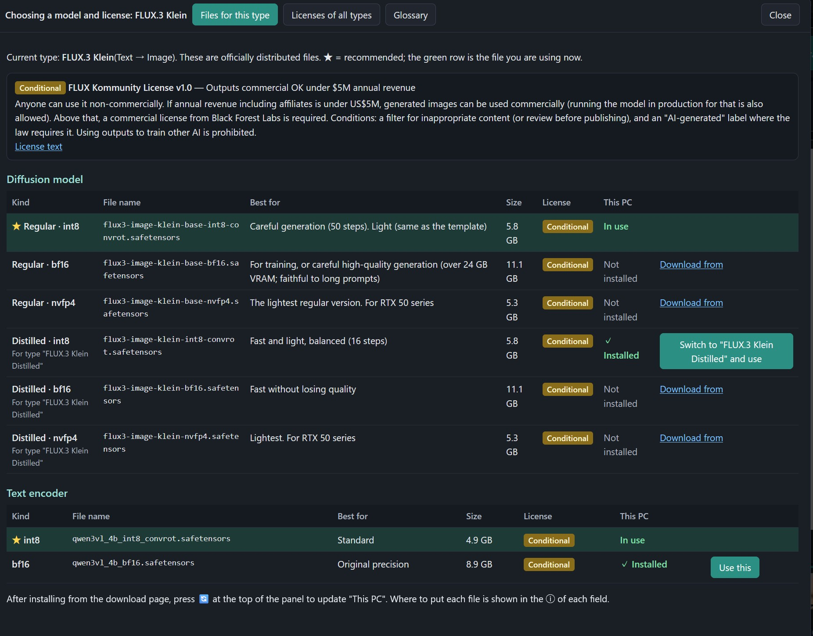

## Supported models

**Image:** MOSS, MOSS Turbo, SD1.5, SDXL, Illustrious, Anima, Krea 2, Qwen Image, Qwen Image Turbo, FLUX.2 Klein (4B / 9B / Base), FLUX.3 Klein, FLUX.3 Klein Distilled

**Video:** Wan2.2 14B / 14B Turbo / 5B / 5B Turbo, LTX-2.5, Kandinsky 6

**Audio:** Qwen3-TTS, LatentSync 1.6, HeartMuLa, ACE-Step 1.5, RVC

Qwen3-TTS needs the ComfyUI-QwenTTS custom node. If the install from ComfyUI Manager fails, open PowerShell in the ComfyUI folder and run `.\venv\Scripts\python.exe -m pip install qwen-tts`.

## More of what CCA Generator does

- **Models** — Add model folders, including all StabilityMatrix folders at once.
- **Settings** — Export everything to one file (CCA Generator settings, presets, wildcards, templates, editor settings, layout, model folders) and import it back, merging or replacing.
- **Fast** — split execution: change only the seed and the model isn't reloaded.
- **Language** — Japanese / English UI switching (auto-detect supported).


## Models

This node does not bundle any models. If you don't have models yet, CCA Generator's model setup assistance helps you download them and place them in the right folders. See the model guide in CCA Generator for how to choose a model and its license terms.

## Usage

1. **Open the workflow** — Open the CCA Generator workflow from ComfyUI's template browser (Workflow → Browse Workflow Templates), or drag `example_workflows/cca_generator_workflow.json` (Japanese) or `example_workflows/cca_generator_workflow_en.json` (English) onto the canvas.
2. **Choose a model** — Pick a model type (e.g. MOSS, LTX-2.5) from the model dropdown. Use the model folder settings to point to where your models are stored.
3. **Choose a task** — Text-to-image, image-to-image, text-to-video, or image-to-video.
4. **Enter a prompt** — Pick a preset or type your own. For video, you can also add audio or dialogue lines.
5. **Set input images** — For image-to-image and image-to-video. The first image is the opening frame; the second is the optional ending frame. Click to select, or drag and drop.
6. **Press Generate** — Press Stop to interrupt. Progress is shown during generation.
7. **Edit the result** — Open an image in the image editor (background removal, object removal) or a video in the video editor (join, subtitles, overlays).
8. **Check the results** — Preview images and videos in the gallery, enlarge them, or open the output folder.

## License

### This node

CCA Generator is licensed under GPL-3.0 — see [LICENSE](LICENSE).

This node is provided "as is", without warranty of any kind. Use it at your own risk — no responsibility is taken for any damage or loss arising from its use. (GPL-3.0, sections 15–17)

### Model licenses

This node does not bundle any models. Each model you download has its own license, which applies to the model weights (and, for some models, to how the model itself may be used in a product). The table below is a summary as of November 2026 — always check the license file on the model page of the exact checkpoint you download before commercial use.

| Model | License | Commercial use |
|---|---|---|
| MOSS / MOSS Turbo | Apache-2.0 | Yes |
| SD1.5 | CreativeML Open RAIL-M | Yes, with use-based restrictions |
| SDXL | CreativeML Open RAIL++-M | Yes, with use-based restrictions |
| Illustrious | Varies by checkpoint — v0.1: Fair AI Public License 1.0-SD; v2.0: CreativeML Open RAIL-M | Check the checkpoint you use |
| Anima | CircleStone Labs Non-Commercial License (+ NVIDIA Open Model License) | Commercial use of the model itself: no; commercial use of generated images: yes |
| Krea 2 | Krea 2 Community License | Free under $1M annual revenue and under 50 seats |
| Qwen Image | Apache-2.0 | Yes |
| Qwen Image Turbo | Apache-2.0 | Yes |
| FLUX.2 Klein 4B / 4B Base | Apache-2.0 | Yes |
| FLUX.2 Klein 9B / 9B Base | FLUX Non-Commercial License | Commercial use of the model itself: no; commercial use of generated images: yes |
| FLUX.3 Klein / FLUX.3 Klein Distilled | FLUX Kommunity License v1.0 | Generated images only, for users under $5M annual revenue |
| Wan2.2 (14B / 14B Turbo / 5B / 5B Turbo) | Apache-2.0 | Yes |
| LTX-2.5 | LTX-2.x Community License | Free under $10M annual revenue |
| Kandinsky 6 | MIT for the model itself; the HunyuanVideo VAE is under the Tencent Hunyuan Community License (not valid in the EU, UK, or South Korea) | Yes, but see the note below |
| Qwen3-TTS | Apache-2.0 | Yes |
| LatentSync 1.6 | CreativeML Open RAIL++-M (code: Apache-2.0) | Yes, with use-based restrictions |
| HeartMuLa | Apache-2.0 | Yes |
| ACE-Step 1.5 | MIT | Yes |
| RVC | MIT | Yes |

Notes:

- **Qwen Image Turbo:** first-generation Qwen-Image with the LightX2V Qwen-Image-Lightning 8-step LoRA (`Qwen-Image-Lightning-8steps-V1.1.safetensors`). It is not Qwen-Image-2.1-Turbo, which is under the Qwen Research License (non-commercial).
- **Illustrious:** licenses differ by version, and community merges inherit the terms of what they were merged from. Read the page of the exact checkpoint you download.
- **Kandinsky 6:** the model itself is MIT, but the video VAE it uses comes from HunyuanVideo, under the Tencent Hunyuan Community License. That license does not apply in the EU, the UK, or South Korea, and products with over 100M monthly active users need a separate agreement with Tencent. The other components (Qwen2.5-VL text encoder, CLIP, MMAudio VAE, BigVGAN vocoder) are under permissive licenses.
- This summary is not legal advice. When in doubt, read the license text that ships with the model.

## Support

If this node is useful to you, you can [support CCA Generator on Ko-fi](https://ko-fi.com/cocoat).

## Other projects

[cocoamix](https://civitai.com/collections/13386306) — a checkpoint family made since the SD1.5 era, MOSS versions included.

[](https://civitai.com/collections/13386306)
